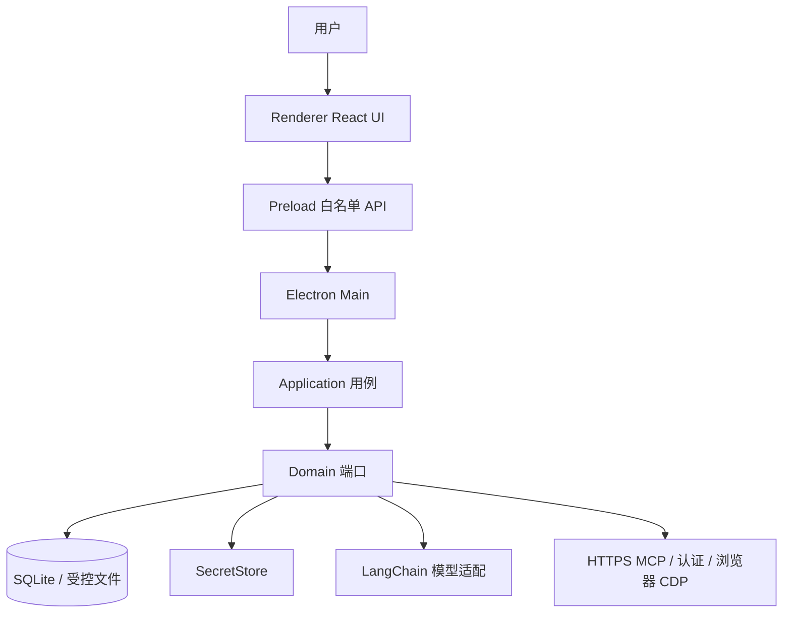

<p align="center">
  
</p>

<h1 align="center">Zimo</h1>

<p align="center">
  本地优先的桌面 AI Agent 工作空间。对话、知识、Skill、工作流、MCP 与本机自动化都在 Electron 应用内完成。
</p>

<p align="center">
  <a href="#快速开始"><strong>快速开始</strong></a> ·
  <a href="docs/README.md"><strong>文档索引</strong></a> ·
  <a href="REQUIREMENTS.md"><strong>需求</strong></a> ·
  <a href="IMPLEMENTATION_PLAN.md"><strong>实施计划</strong></a> ·
  <a href="PROGRESS.md"><strong>进度</strong></a>
</p>

<br>

Zimo 面向需要用自然语言完成任务的个人和团队：流式对话、本机知识检索、Agent/Skill 组合、可视化工作流、公网 HTTPS MCP，以及应用存活期内的本地调度。会话数据、文档副本和密钥默认留在本机；模型通过登录账号托管或显式配置的 OpenAI-compatible 服务访问。

> **一句话理解 Zimo：** 界面只负责交互，真正的模型、文件、浏览器和外部服务都由 Main 与 Application 在受控边界内执行。

本仓库是 Zimo Desktop 与产品介绍站点的源码。当前目标版本为 **V0.2**，整体进度到 **Phase 10（本地 Automation 调度）**，并已接入本机浏览器自动化等后续增量。未列入当前阶段的能力可以出现在界面设计中，但不得被描述为已经可用。

## 快速开始

需要 Node.js 22.12+ 和 pnpm 10。

```bash
pnpm install --frozen-lockfile
pnpm dev
```

macOS 也可使用 `pnpm dev:mac`。页面必须在 `pnpm dev` 启动的 Electron 窗口中运行，不要用浏览器直接打开 Renderer 的 `file://` 地址。

登录使用 Zimo 统一身份认证（员工账号 ID / 注册手机号 + 密码）。密码不落库；Token 由 Main 写入系统安全存储。登录后即可使用账号托管的默认模型开始任务。

功能说明页（用户端 / 企业管理端，不连接桌面 IPC 或用户数据）：

```bash
pnpm dev:website
```

详细环境、门禁和阶段验收见 [本地开发与验收](docs/development/getting-started.md)。

## 为什么是桌面应用

把 Agent 做成一次演示，与把它做成可日常使用的本机工作空间，是两件事。Zimo 把身份、会话、知识、工具、审批和审计收进同一个 Electron 进程模型，避免在网页里直接接触密钥、数据库和本机文件系统。

- **本地优先。** 会话、文档工作区、知识索引和运行记录保存在本机 SQLite 与受控目录；密钥进入操作系统安全存储。
- **界面无系统权限。** Renderer 不能访问 Node、数据库或任意 IPC channel；能力只通过 Preload 白名单进入 Main。
- **能力可组合。** 同一个任务可以绑定 Agent、Skill、知识库、一个 Workflow 和已连接的 MCP Server，由模型按 Schema 选择工具。
- **执行可取消、可审计。** 长时间运行支持超时与取消；敏感动作走审批；普通日志不写用户正文、文件正文、密钥和工具参数值。
- **模型和数据边界清晰。** 领域模型不绑定某一个厂商 SDK；LangChain、SQLite、MCP 与浏览器 CDP 都作为 Adapter 接入。

如果你只需要一个聊天窗口，托管模型对话已经足够；当你需要把对话、资料、技能、流程和本机工具放在同一套权限模型里时，使用 Zimo。

## Zimo 提供什么

| 能力           | 当前可以完成的工作                                                                                         |
| -------------- | ---------------------------------------------------------------------------------------------------------- |
| 任务与对话     | 登录后流式对话、停止/重新生成、任务列表、自动标题、上下文压缩与用户记忆。                                  |
| 云端与视觉模型 | 登录托管模型；云端目录可选模型；声明视觉能力的模型可对本轮 PNG/JPEG/WebP 附件提问。                        |
| Agent 与 Skill | 人才库/本地 Agent；Skill Store 或本地包装 instruction 与受审核脚本 Skill；会话与 Workflow 复用。           |
| 知识库         | 本机解析常见办公文档，FTS 与向量混合检索，回答保留引用。                                                   |
| 会话文档       | 附件导入受控工作区；模型用 `inspect/read/create/patch/convert` 处理 DOCX/XLSX/PPTX/PDF；图片在对话内展示。 |
| 工作流         | 画布编排开始、知识检索、Skill、受控 Tool、Agent、结束节点；会话或测试面板串行执行可达 DAG。                |
| MCP            | 显式配置的公网 HTTPS Streamable HTTP Server；工具快照授权给会话、Agent 或 Workflow。                       |
| 联网与浏览器   | 受控 `web_search` / `web_fetch`；独立 Profile 的 CDP 浏览器：标签页、快照、截图、导航、点击和输入。        |
| 工作目录       | 绑定本机目录后，模型可按授权读写文件；实验性宿主机命令需逐条审批，尚无 OS 沙箱。                           |
| 自动化         | 应用存活且账号已登录时，按计划在专用会话执行绑定能力；关闭应用即停止调度。                                 |
| 通信渠道       | 个人微信文本指令进入账号隔离的助手会话；邮箱地址可登记。图片、群聊和邮件收取尚未接线。                     |
| 治理           | 动作审批、安全审计、脱敏日志；「检查更新」只提示已是最新版本。                                            |

典型场景包括资料问答、办公文档修改、招聘与网页操作、定时本机任务，以及把已有 HTTPS MCP 服务接到当前对话。

## 当前边界

以下能力尚未开放，或仅部分可用。产品说明不得把它们写成已完成：

- Intent Router **不会**自动执行 Agent、Skill 或 Workflow；
- Workflow **不**编译 LangGraph；条件节点和人工确认可保存在画布上，运行时会拒绝；
- Plugin 代码执行、stdio MCP、私网 MCP、操作系统常驻服务和任意 Shell 默认禁止；
- Automation 只在本机应用存活期调度，不补跑关闭期间的全部周期；
- 微信不能远程授予能力；Telegram 未接线；
- 工作流内部节点暂不读取用户记忆，也不做会话那种自动压缩；
- 实验性 `run_command` 拥有当前操作系统用户权限，不是沙箱。

完整非目标与阶段闸门见 [需求文档](REQUIREMENTS.md) 与 [实施计划](IMPLEMENTATION_PLAN.md)。

## 系统架构



依赖只能朝向 Domain。`packages/contracts` 承载跨进程 DTO 与 Zod Schema，不承载领域行为。

| 层          | 职责                          | 禁止                         |
| ----------- | ----------------------------- | ---------------------------- |
| Renderer    | 页面、输入、可访问性          | Node、数据库、密钥、任意 IPC |
| Preload     | 冻结的 `window.zimo` 白名单   | 业务规则、文件系统           |
| Main        | 窗口、协议、IPC、组合根       | 把领域规则堆进 UI            |
| Application | 用例、事务、取消、流式事件    | React、厂商原始事件          |
| Domain      | 实体、策略、端口              | Electron、LangChain、SQLite  |
| Adapters    | 存储、模型、MCP、浏览器、日志 | Renderer                     |

## 仓库结构

| 路径                    | 组件                                           |
| ----------------------- | ---------------------------------------------- |
| `apps/desktop/`         | Electron 桌面应用（Main / Preload / Renderer） |
| `apps/website/`         | 独立静态产品介绍站                             |
| `packages/domain/`      | 领域实体与端口                                 |
| `packages/application/` | 用例编排与流式运行                             |
| `packages/contracts/`   | IPC / DTO / 事件 Schema                        |
| `packages/adapters/`    | SQLite、认证、模型、MCP、知识、浏览器等实现    |
| `packages/ui/`          | 无业务含义的设计系统                           |
| `migrations/`           | 只向前的 SQLite SQL                            |
| `docs/`                 | 架构、ADR、功能、安全与开发规范                |
| `.agents/skills/`       | 仓库级开发工作流                               |

## 常用命令

```bash
pnpm dev                 # 启动桌面开发版
pnpm dev:website         # 启动介绍站点
pnpm check               # 格式、Lint、类型、单测、集成测试与生产构建
pnpm test                # 单元测试
pnpm test:integration    # 集成测试
pnpm test:e2e            # 先构建再跑 Playwright
pnpm build               # Desktop 生产构建
```

打包、字节码保护和平台注意见 [桌面应用打包](docs/development/packaging.md)。协作规则见 [AGENTS.md](AGENTS.md)。

## 文档从哪里读

| 文档                                                          | 用途                         |
| ------------------------------------------------------------- | ---------------------------- |
| [文档索引](docs/README.md)                                    | 全部功能、架构与问题记录入口 |
| [架构总览](docs/architecture/overview.md)                     | 分层、运行时流程与安全默认值 |
| [威胁模型](docs/security/threat-model.md)                     | 信任边界与禁止项             |
| [Workflow Runtime](docs/features/workflow-runtime-v0.md)      | 当前可执行节点与限制         |
| [Automation 本地调度](docs/features/automation-scheduler.md)  | 应用存活期调度规则           |
| [本地浏览器自动化](docs/features/local-browser-automation.md) | CDP 能力与禁止项             |

## 许可证

本仓库为 Zimo 内部产品源码。分发、打包通道和商业授权以团队发布约定为准，不以第三方社区许可证描述。
