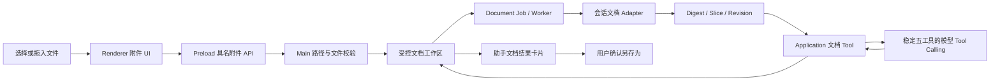

# 会话文档工作区与模型工具设计

实施状态：Phase 8A–8E 首版已于 2026-09-14 落地，等待 macOS/Windows 人工验收。

状态：首版已实现
日期：2026-09-14
目标阶段：V0.2 Phase 8

## 目标

在会话中提供 Word、Excel、PowerPoint 和 PDF 的创建、读取、受控修改与转换能力，同时满足：

- 用户可以从输入区的独立“文件”分区选择文件，也可以把文件拖入聊天窗口；
- 文件不是 Agent、Skill、知识库、Workflow 或 MCP 的长期绑定，而是当前消息和会话的文档资产；
- 模型只能通过少量高层文档 Tool 操作文档资产，不能获得本地路径、任意文件系统或第三方库 API；
- 二进制文件和完整正文默认不进入模型上下文、Renderer 全局状态或普通日志；
- 第一阶段不依赖系统 Python、Office、LibreOffice 或用户额外安装的软件。

“创建、读、改、转换”不是一个统一强度的承诺。首版目标是常见办公任务可靠可用，不承诺对任意复杂 Office/PDF 文件进行像素级无损往返编辑。

## 当前项目基础

Zimo 已有两块可复用能力：

1. `@zimo/knowledge-local` 使用 `officeparser@7.8.0` 解析 DOCX、XLSX、PPTX、PDF，具备文件大小、解析超时、解压规模和结构位置限制；该包因动态解析器/worker 需要保留 Node 运行时目录，已作为 Desktop 生产依赖并从 Main bundle 外置；
2. Phase 7 的 `ControlledToolService` 已具备模型本轮暴露校验、参数 Schema、超时、取消、结果上限和脱敏审计。

但知识库导入只面向“提取文本并建立索引”，不保存可编辑的统一文档模型；当前 Controlled Tool 也不允许任意文件写入。因此不能把知识库解析器或 Skill 脚本直接当作文档编辑器。

仓库中的 `apps/desktop/resources/skills/minimax-*`、`pptx-generator` 等开发源文件依赖 Python、Shell、.NET 或外部命令，而且打包配置明确排除了整个 `resources/skills`。它们可以作为测试样例和交互参考，不能作为桌面应用的基础运行时。

## 用户交互

### 输入区分区

“+”菜单底部增加与其他能力视觉分离的灰色次级“添加文件”操作：

```text
┌──────────────────────────────┐
│ Agent                    ›   │
│ Skills                  ›   │
│ 知识库                   ›   │
│ Workflow                ›   │
│ MCP Servers             ›   │
├──────────────────────────────┤
│ 添加文件（文档附件）          │
└──────────────────────────────┘
```

- “添加文件”是直接动作，不进入二级菜单；点击后由 Main 打开系统文件选择器；
- 文件入口使用小号灰色文字和独立分隔线，作为低于 Agent/Skill 等能力的附加操作；
- 接受格式、数量和大小在副文案或 tooltip 中明确，不以失败后猜测代替预期管理；选择器与拖放导入覆盖知识库可解析的文档/文本，不含可执行文件、通用压缩包或图片。

### 拖放

- 文件进入消息区域时显示全窗口内的轻量蒙层：“释放以添加到当前任务”；
- 只接受操作系统文件拖放，不把网页 URL、HTML 或选中文本当作本地文件；
- Preload 使用 Electron 受控文件映射取得路径并直接交给 Main，Renderer 业务状态只接收 `artifactId` 和安全元数据；
- 无效格式、空文件、超限文件和符号链接逐项显示错误；部分文件失败不丢弃已成功导入的文件；
- 导入中展示进度和取消；重复文件提示复用已有资产或创建新版本。

### 草稿附件和结果卡片

- 文件处理状态和草稿附件显示在输入框下方，使用紧凑灰色附件项，包含类型图标、文件名、大小和移除按钮；
- 附件属于当前草稿。发送成功后通过 `message_artifact_bindings` 绑定到用户消息；取消草稿时清理未引用的临时资产；
- 助手创建或修改文档后返回“文档结果卡片”，展示名称、格式、版本、变更摘要以及“预览 / 另存为”；
- 默认创建新版本，不覆盖用户原文件。只有用户在系统“另存为”对话框中确认后，才写入工作区之外的位置；
- 输入卡片固定到发送时的 revision，输出卡片固定到本轮最终 revision；以后继续编辑不会改变历史卡片所指向的内容；
- 后续可增加版本对比和恢复，首版至少保留输入原件与最新产物。

## 纯 Node.js 能力评估

### 结论

常用 Node.js 组件不能完成所有格式的任意高保真创建、读取、修改和互转，但能支撑一个边界清晰、跨平台一致的首版。推荐使用“统一文档中间结构 + 格式 Adapter”，而不是让模型直接编写 JS、XML 或调用库方法。

| 格式      | 推荐组件                          | 创建                                           | 读取                     | 修改                                         | 首版转换边界                                        |
| --------- | --------------------------------- | ---------------------------------------------- | ------------------------ | -------------------------------------------- | --------------------------------------------------- |
| DOCX      | 现有 `officeparser` + `docx`      | 报告、标题、段落、列表、表格、图片、页眉页脚   | 结构和正文               | 模板占位符替换、追加结构块、Zimo 文档重建    | DOCX→文本/HTML/Markdown；不承诺任意 DOCX→PDF 高保真 |
| XLSX      | 现有 `officeparser` + `exceljs`   | 工作表、单元格、格式、公式、表格、图片         | Sheet/Range/公式/缓存值  | 常规单元格、行列、格式和公式修改             | XLSX↔CSV、结构化 JSON；不承诺图表/宏/透视表无损往返 |
| PPTX      | 现有 `officeparser` + `pptxgenjs` | 从零或主题模板生成文本、图形、表格、图片、图表 | 幻灯片结构和正文         | Zimo 中间结构生成的 PPT、受控模板槽位        | PPTX→文本/大纲；不承诺任意 PPTX 无损编辑或 PPTX→PDF |
| PDF       | `pdfjs-dist`/现有解析 + `pdf-lib` | 页面、文本、图片、矢量、表单                   | 页面、文本、元数据、渲染 | 合并、拆分、重排、表单、水印、页码、叠加内容 | PDF→文本/图片；Zimo HTML/文档→PDF；不支持正文重排   |
| OOXML ZIP | `jszip`                           | 不作为产品级创建入口                           | 检查包结构               | 仅用于经过测试的窄范围补丁                   | 不直接向模型开放                                    |

能力依据：

- [`docx`](https://docx.js.org/) 提供声明式 DOCX 生成；其 [`patchDocument`](https://docx.js.org/api/functions/patchDocument.html) 面向已设计模板的占位符替换，不代表通用 Word 编辑器；
- [`ExcelJS`](https://github.com/exceljs/exceljs) 能读取和写入 XLSX、样式与公式，但不是完整 Excel 计算/渲染引擎；公式结果需要 Excel、LibreOffice 或额外计算引擎计算；
- [`PptxGenJS`](https://gitbrent.github.io/PptxGenJS/docs/introduction/) 明确以生成演示文稿为核心，适合 Zimo 从中间结构创建 PPTX，不提供任意现有 PPTX 的完整对象模型往返；
- [`pdf-lib`](https://github.com/Hopding/pdf-lib#limitations) 能创建、合并、拆分、填表和叠加内容，但不能提取或编辑普通页面正文；[`PDF.js`](https://mozilla.github.io/pdf.js/) 定位是解析和渲染；
- 现有 [`officeparser`](https://www.npmjs.com/package/officeparser) 可继续负责 Office/PDF 的结构提取；不要新增四套重复读取链路；
- [`Mammoth`](https://github.com/mwilliamson/mammoth.js) 可作为 DOCX→HTML 的候选，但官方说明它偏语义转换、会忽略部分样式，而且输出不做消毒；只有在 `officeparser` 的 HTML 输出不能满足需求时再引入。

### 为什么不能承诺所有转换

Office→PDF 或 Word↔PPT 不是简单改文件后缀，而是排版引擎、字体度量、分页、图表、公式、SmartArt、主题和兼容模式共同决定的渲染结果。纯 JS 库通常生成或修改 OOXML，不包含与 Microsoft Office 等价的渲染引擎。

首版可以把 Zimo 自己的结构化文档渲染为受控 HTML，再使用 Electron 自带 Chromium 的 [`webContents.printToPDF`](https://www.electronjs.org/docs/latest/api/web-contents#contentsprinttopdfoptions) 生成 PDF。这能保证 Zimo 自己创建内容的稳定输出，但不能把任意外部 DOCX/PPTX 高保真转换成 PDF。

高保真转换若后续成为刚需，应增加独立 `DocumentConversionProvider`：

- 本地方案：按平台随应用分发并隔离 LibreOffice/专用 SDK，承担明显的安装包体积、启动进程、字体和许可证成本；
- 云端方案：Microsoft Graph、腾讯文档等已授权服务，承担文件外发、网络、费用和数据合规成本；
- 不允许在用户不知情时自动回退到外部服务。

### Python 策略

首版不依赖 Python。系统 Python 的版本、路径、依赖和打包在 macOS/Windows 上不一致，会复现当前 Skill 运行时的兼容风险。Python 2 已停止维护，不应支持。未来确有 JS 无法覆盖的 OCR、复杂数据分析或格式处理需求时，只考虑按目标平台随应用固定分发一个 Python 3 Runtime，并把它作为独立、可替换、受限的 Adapter；不能调用用户电脑上的任意 `python`。

## 统一文档模型

模型不直接操作第三方 SDK。Domain 定义稳定的 `DocumentArtifact`、`DocumentRevision`、`DocumentDigest` 和格式化操作：

```text
DocumentArtifact
├─ id / conversationId / displayName / mediaType
├─ format: docx | xlsx | pptx | pdf | txt | md | html | json | csv | rtf | odt | ods | odp | epub
├─ currentRevisionId / status
└─ capabilities: inspect | read | create | patch | convert

DocumentRevision
├─ id / artifactId / parentRevisionId / checksum
├─ storageKey / createdBy / createdAt
└─ summary（不含正文）
```

格式 Adapter 只接收受控存储句柄和严格操作，不接收调用方提供的绝对路径：

```ts
interface DocumentFormatAdapter {
  inspect(input: InspectDocumentInput, signal: AbortSignal): Promise<DocumentDigest>;
  read(input: ReadDocumentSliceInput, signal: AbortSignal): Promise<DocumentSlice>;
  create(input: CreateDocumentInput, signal: AbortSignal): Promise<DocumentRevisionResult>;
  patch(input: PatchDocumentInput, signal: AbortSignal): Promise<DocumentRevisionResult>;
  convert(input: ConvertDocumentInput, signal: AbortSignal): Promise<DocumentRevisionResult>;
}
```

推荐的中间结构只表达 Zimo 承诺支持的语义块：标题、段落、列表、表格、图片引用、分页/分节、Sheet/Range、Slide 和 PDF 页面操作。未知 OOXML 特性保留在源文件中，但不声称可编辑。

## 提供给大模型且控制 Token

### 不采用的方式

- 不把 `docx`、ExcelJS、PptxGenJS、pdf-lib 的全部 API 放进 Tool 描述；
- 不把 OOXML、Base64、完整文件或整本正文放入 messages；
- 不为每个单元格、段落、幻灯片和 PDF 操作注册一个 Tool；
- 不靠超长 Skill Prompt 教模型写脚本。

### 稳定暴露

模型只看到五个产品级 Tool，不看到底层库。每次会话模型调用都完整、稳定地暴露以下 Tool，由模型通过 Tool Calling 自行判断是否调用；Application 不再根据用户文本的关键词或正则表达式筛选文档 Tool：

| Tool                    | 用途                                                    |
| ----------------------- | ------------------------------------------------------- |
| `zimo.document.inspect` | 返回页/Sheet/Slide 数、标题、目录、可用 selector 和警告 |
| `zimo.document.read`    | 返回指定页、Sheet、Slide 或 cursor 对应的有界内容       |
| `zimo.document.create`  | 创建新文档并返回短引用与生成摘要                        |
| `zimo.document.patch`   | 修改当前会话文档并返回新 revision 的短引用与变更摘要    |
| `zimo.document.convert` | 语义重建为目标格式并返回短引用、转换等级和可能损失      |

五个稳定 Schema 的数量和体积有界，避免“处理一下错别字”“按刚才的建议调整”等上下文表达因未命中关键词而缺失写入 Tool。Tool 是否可执行仍由当前会话文档归属、参数 Schema、权限与受控工作区边界决定；暴露 Tool 不等于扩大文件访问范围。大量 MCP Tool 的延迟发现另行设计，不复用文档文本匹配。

`patch.operations` 会把八种受支持操作的准确字段名、类型和边界完整提供给模型。例如 `replace_text` 明确使用 `search/replacement`，而不是依赖一段自然语言说明让模型猜测 `find/replace` 等参数别名。同一文档同一模型轮次的多个 patch 调用还会在 Application 合并为一次操作批次，只读取一次源文件、按顺序应用并持久化一个最终 revision；Application 仍以同一组严格解析规则执行最终校验。

### 渐进读取

1. Main 导入后按预览或发送动作本地生成 `DocumentDigest`；
2. 本轮新附件或明确文档后续请求会得到会话内短引用（`doc_1`）、显示名、格式、页/Sheet/Slide 目录和短预览；所有附件合计最多 6,000 字符，并标记为不可信资料；
3. 模型通过 selector 精确读取，例如 `pages: [2,3]`、`sheet: 销售额, range: A1:F50`、`slides: [1,4]`；
4. 单次 Tool 输出和本轮累计正文均设预算，超限返回可继续分页的 cursor；
5. patch 只传短引用和结构化差异数组；Application 在执行瞬间解析内部 artifact/revision ID，批量修改只提交一个最终 revision，并继续使用 revision 乐观锁；
6. 二进制、内部 UUID 和 revision ID 始终留在受控工作区，不要求模型跨轮复制长标识符。

`doc_n` 按当前会话中已绑定消息的文档创建顺序生成，仓储以 `created_at, id` 稳定排序，因此应用重启后引用不变。短引用只能解析到当前会话已发送的文档；草稿和其他会话的文档不会进入引用表，也不能通过短引用访问。

这样 Token 消耗与“模型实际读取的区域”相关，而不是与文件总体积或底层库 API 数量相关。文档 Tool 的描述保持稳定，可由现有 Tool Calling 循环按轮次加入或移除。

## 架构与数据流



- Renderer 只做选择、拖放意图、进度和结果展示；
- Preload 只暴露 `attachments.select/importDropped/remove/export/cancel` 等具名 API；
- Main 校验 sender、路径、文件签名和工作区边界，装配 Worker 与 Adapter；
- Application 拥有资产生命周期、revision 并发控制、Tool 筛选和错误语义；
- 首版解析/生成位于 Main Adapter，具备 30 秒 AbortSignal 与输入/输出预算；在复杂真实文件容量测试前仍需迁移到 Worker/Utility Process，避免同步 XML/ZIP 工作阻塞 Main；
- Domain/Contracts 新建独立 `documents` 模块，不写回当前超限的 Contracts/SQLite 聚合入口。

## IPC 与持久化草案

### 具名 IPC

- `zimo:artifacts:select:v1`：Main 打开文件选择器并导入；
- `zimo:artifacts:import-dropped:v1`：Preload 将拖放文件映射给 Main；
- `zimo:artifacts:list:v1`：按会话/消息返回安全元数据；
- `zimo:artifacts:remove:v1`：移除草稿引用或删除未引用资产；
- `zimo:artifacts:export:v1`：由 Main 打开“另存为”，只接受 artifact/revision ID；
- `zimo:document-jobs:cancel:v1` 与进度事件：取消导入、解析、生成和转换。

`SendMessageInput` 增加最多 10 个 `artifactIds`，Main 再校验它们属于当前用户和会话。任何 IPC 都不接受模型生成的绝对输出路径。

### 数据表

使用下一可用 migration 增加：

- `document_artifacts`：会话归属、显示名、媒体类型、状态、当前 revision；
- `document_revisions`：父版本、受控 `storage_key`、checksum、创建来源和非正文摘要；
- `message_artifact_bindings`：消息与输入/输出资产关系；
- `document_jobs`：首版前台任务复用会话 run/IPC 超时而未新增该表；迁移 Utility Process 或增加后台转换时再加入，保存任务类型、状态、进度、错误码与时间信息，不保存正文。

文件保存在 `app.getPath("userData")/workspaces/<conversationId>/<artifactId>/` 的会话 Workspace 容器中；普通文本输出位于同一会话的 `files/` 子目录。数据库只保存随机 storage key，不保存用户原始绝对路径。删除任务时先删除资产记录，再尽力清理托管副本。

## 安全边界

- 导入白名单与知识库可解析格式对齐：`.docx/.xlsx/.pptx/.pdf/.txt/.md/.markdown/.html/.htm/.json/.csv/.rtf/.odt/.ods/.odp/.epub`，同时校验扩展名、UTF-8/媒体签名和 ZIP 必需部件；旧 `.doc/.xls/.ppt`、可执行文件、通用 `.zip`、图片和宏格式不接受；
- 创建、修改和转换目标仍只允许 DOCX、XLSX、PPTX、PDF；其余导入格式仅支持 inspect/read，以及转换为上述四种可编辑格式；
- 宏格式 `.docm/.xlsm/.pptm`、加密/密码文件、嵌入 OLE、外部链接抓取和 PDF JavaScript 首版拒绝或只读忽略，绝不执行；
- 复用知识导入的 20 MB 单文件上限作为初始值，每条消息最多 10 个文件；另限制解压总量、ZIP 条目、图片像素、表格单元格和生成页数；数值在容量测试后固化；
- 导入立即复制到工作区，后续不继续读取用户原路径，拒绝符号链接和路径逃逸；
- 修改只生成新 revision。模型无权覆盖原件、选择任意路径、启动命令、联网加载模板/图片或调用系统 Office；
- 外部文档内容和 Tool 输出是不可信数据，不能成为权限指令；DOCX→HTML 输出必须 sanitization 后才能预览；
- 所有操作支持 AbortSignal、30 秒超时、唯一终态和资源释放；压缩炸弹、恶意 XML、超大图片和病态 PDF 受输入/解压预算限制，但首版尚未获得 OS 进程级隔离；
- 普通日志只记录 artifact/revision/job ID、格式、大小、页数、操作、耗时、结果和错误码，不记录文件名（可选 hash）、正文、单元格值、Tool 参数值或输出；
- 附件授权只覆盖当前会话内的 opaque artifact。读取可以自动执行；创建/修改只写内部新版本；导出到用户文件系统必须由用户点击并确认。

## 分阶段实施步骤

### Phase 8A：契约、工作区与附件 UI

1. 新建 Domain/Contracts 的 document 模块、错误码和 migration；
2. 实现受控工作区、导入、草稿/消息绑定、删除清理和导出；
3. 在“+”菜单增加独立文件分区，在聊天窗口增加拖放层、附件条和结果卡片；
4. 复用现有安全校验并补路径、ZIP bomb、取消、并发和隐私测试。

Exit gate：附件可跨会话恢复；Renderer/日志/SQLite 不出现源绝对路径或正文；打包态 macOS/Windows 导入与导出 smoke 通过。

### Phase 8B：只读与预览

1. 从 `officeparser` 提取可复用 `DocumentReader`，避免与知识库重复解析；
2. 增加 digest、selector 和分页读取；
3. PDF 使用 PDF.js 或现有解析能力做页面预览，Office 先提供结构/文本预览；
4. 接入 `inspect/read` 两个受控 Tool 和 token 预算。

Exit gate：四种格式均能按页/Sheet/Slide/结构读取，大文件不会整份进入模型上下文。

### Phase 8C：创建

1. 先做统一块模型与 DOCX/PDF；
2. 再做 XLSX 的数据、样式、公式与校验；
3. 最后做 PPTX 的主题、布局、溢出检查和预览；
4. 每种格式用固定 golden fixtures 在 Word/Excel/PowerPoint/主流 PDF Viewer 人工 smoke。

Exit gate：产物可由主流办公软件打开，无损坏提示；失败不留下可见的半成品 revision。

### Phase 8D：有限修改与版本

1. DOCX 首批支持模板槽位、替换、追加和 Zimo 文档块重建；
2. XLSX 支持范围值/公式/样式、增删行列，并明确不计算完整 Excel 公式；
3. PPTX 只修改 Zimo 中间结构或声明过的模板槽位；
4. PDF 支持合并、拆分、重排、表单、水印、页码和叠加；
5. 所有 patch 使用 `expectedRevisionId` 做乐观并发控制。
6. 同一批次的多项修改只生成一个最终 revision，并原子绑定到当前 assistant 回复；源 revision 继续保留。

Exit gate：源 revision 保留、变更摘要准确、冲突和不支持特性返回稳定错误。

### Phase 8E：转换与质量收口

1. 开放 DOCX/PPTX/PDF→文本/结构，XLSX↔CSV，以及 Zimo 结构化内容→四种目标格式；
2. 使用受控本地 HTML print renderer 生成 Zimo 内容 PDF；
3. 在 UI 显示转换等级：`结构保留 / 可能损失格式 / 不支持`；
4. 评估高保真 `DocumentConversionProvider`，未单独批准前不接 LibreOffice、云端上传或原生 SDK；
5. 做包体积、许可证、性能、内存、字体替代和 Windows/macOS 打包验收。

Exit gate：支持矩阵与实际行为一致，不能通过降级或伪造文件扩展名声称转换成功。

## 测试范围

- Unit：格式能力矩阵、Tool 动态筛选、selector、revision 冲突、错误映射和 token 预算；
- Contract：四个 Adapter 对相同 inspect/read/create/patch/convert 契约的支持与拒绝行为；
- Integration：文件签名、路径、压缩限制、Worker 取消、migration、事务与清理恢复；
- Component/E2E：点击添加、拖放、部分失败、发送绑定、重新打开任务、结果卡片、另存为和取消；
- Security：符号链接、目录逃逸、ZIP bomb、外部关系、宏/加密文件、HTML/XSS、日志 canary 和 Renderer Node 隔离；
- Packaging：macOS x64/arm64 与 Windows x64 的创建、打开、中文字体、图片、公式和 PDF 输出 smoke。

## 明确非目标

- 首版不做完整 Word/Excel/PowerPoint 可视化编辑器；
- 不支持旧二进制 `.doc/.xls/.ppt`、VBA 宏执行、OLE、密码破解、OCR 和手写识别；
- 不保证任意外部 DOCX/PPTX 的像素级无损往返修改；
- 不提供完整 Excel 公式计算引擎；
- 不提供 PDF 普通正文的语义重排编辑；
- 不依赖系统 Python、系统 Office 或用户自行安装的命令行工具；
- 不把会话附件自动导入知识库；用户需要长期检索时仍显式加入知识库。

## 首版实际能力矩阵

| 格式 | 读取/预览        | 创建                           | 修改                                         | 转换                                      |
| ---- | ---------------- | ------------------------------ | -------------------------------------------- | ----------------------------------------- |
| DOCX | 结构与有界文本   | 标题、段落                     | 文本替换、追加后重建新 revision              | 与其他三格式语义重建，不保证样式保留      |
| XLSX | Sheet 与有界文本 | 表格、基础列宽、首行加粗、公式 | 指定起始单元格写入值或公式                   | 与其他三格式语义重建；CSV 文件产物未开放  |
| PPTX | Slide 与有界文本 | 标题/正文幻灯片                | 仅 Zimo 产物文本重建；外部 PPTX 拒绝直接修改 | 与其他三格式语义重建，不保证主题/布局保留 |
| PDF  | Page 与有界文本  | Chromium 生成中文 PDF          | 拆分/重排、表单、水印、页码、文本叠加        | 与其他三格式语义重建；不重排普通正文      |

写操作只创建应用管理目录内的新 artifact/revision；创建、转换和修改后的最终 revision 随当前 assistant 消息显示。输入/输出消息分别保存具体 revision 引用，预览和另存为不会随未来修改漂移。预览只返回最多 2,000 字符，`read` 单次最多 12,000 字符，相关模型请求所有附件正文合计最多 6,000 字符。每次会话模型调用固定暴露五个产品级文档 Tool，模型可不调用并直接回答普通聊天；工具执行仍严格限定在当前任务受控工作区。

## 已确认与后续决策点

1. Phase 8A 已采用 20 MB/文件、10 文件/消息的初始限制；
2. DOCX 模板槽位、XLSX 样式/行列操作、PPTX 官方模板与 PDF 多资产合并尚未开放；
3. PDF 首版为结构/文本预览，不包含逐页图像缩略图；
4. 高保真 Office→PDF 明确延期，后续单列本地 LibreOffice/云端 Provider spike；
5. 复杂解析迁移 Worker/Utility Process 是发布前容量治理项，不能因已有 AbortSignal 宣称进程级隔离；
6. 资产随任务删除；若以后增加任务回收站，资产保留策略随之单独设计。
