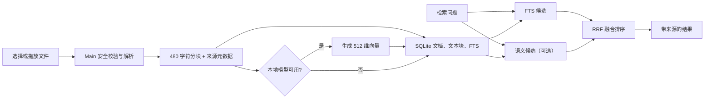

# Knowledge Retrieval V0

## 已实现范围（Phase 6A–6B）

知识库详情页现在提供真实的本地导入和检索闭环：

- 选择或拖放 TXT、Markdown（`.md`/`.markdown`）、JSON、HTML、CSV、PDF、DOCX、XLSX、PPTX、RTF、ODT、ODS、ODP、EPUB；Markdown 使用独立 UTF-8 解析路径，并保留 ATX 标题作为来源信息；
- 将原文件安全复制到应用管理目录，以 SHA-256 内容摘要去重；
- 按文档结构解析，并保留页码、幻灯片号、工作表名、标题与文本位置；
- 文档元数据、文本块和向量跨重启持久化；
- 未安装模型时使用 SQLite FTS5 关键词检索；
- 应用内置本地 BGE 模型，对现有和新文档生成向量并提供混合检索；
- 结果显示来源文档、定位信息、匹配类型和归一化排名分数；
- 删除文档或知识库时同步删除其索引和受管理文件。

## 模型说明

固定模型为 `Xenova/bge-small-zh-v1.5` 的指定 revision，运行格式为 INT8，向量维度为 512。约 23 MB 的模型位于 `apps/desktop/resources/models`，通过 Electron Builder `extraResources` 随包分发；运行时禁止远程模型加载。

本地模型的优点是业务文本默认不外发、首次启动无需下载、离线可检索且没有按调用计费。代价是安装包增大和本地推理成本；低配置设备上的批量建库会更慢。资源校验失败时 FTS 降级仍保证基础检索能力。

## 检索流程

## 后续范围

- 普通会话与 Agent 的显式选择、受控上下文和来源快照已在 Phase 6C 接通，详见 [Knowledge Grounding V0](knowledge-grounding-v0.md)；
- 数据库只读连接、SQL 模板/视图 allowlist、凭据存储与增量游标；
- 企业内部管理后台的 API/Webhook/定时同步、失败重试和审计；
- OCR、扫描 PDF、图片内容、多模态 Embedding；
- 后台 Utility Process、进度、取消和断点续建；
- 大规模 ANN 向量索引。

下一增量为 Workflow 知识检索节点。外部数据库和管理后台属于后续 Source Adapter 与同步任务，禁止模型自由生成 SQL 或操作后台。
