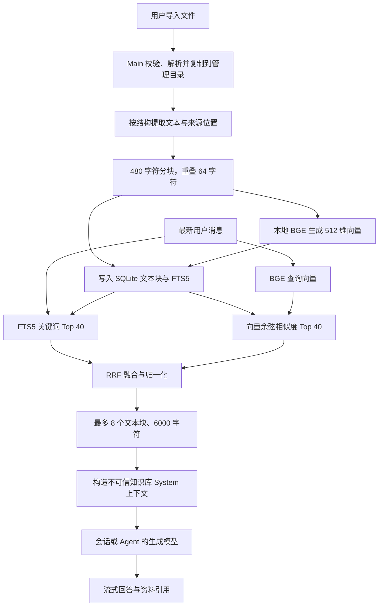

# RAG 实现说明

状态：已实现（Phase 6A–6C，Workflow 在 Phase 7 接入）  
更新日期：2026-09-07

## 一句话概览

Zimo 当前使用完全本地的 `BGE Small 中文 v1.5` 生成 Embedding，并将语义检索与 SQLite FTS5 关键词检索通过 RRF 融合；召回的资料作为受控 System 上下文交给用户当前选择的生成模型回答，同时保存并展示来源引用。

## 使用的模型和组件

| 职责           | 当前实现                                                                                          |
| -------------- | ------------------------------------------------------------------------------------------------- |
| Embedding 模型 | `BAAI/bge-small-zh-v1.5` 的 Transformers.js ONNX 转换版 `Xenova/bge-small-zh-v1.5`                |
| 模型版本       | 固定 revision `75c43b069aac4d136ba6bc1122f995fedcfd2781`                                          |
| 推理格式       | INT8 / Q8 ONNX，约 23 MB，随应用安装包分发                                                        |
| 推理运行时     | `@huggingface/transformers`，本地 `feature-extraction` pipeline                                   |
| 向量形式       | 512 维，CLS pooling，归一化向量                                                                   |
| 关键词索引     | SQLite FTS5，`trigram case_sensitive 0` tokenizer                                                 |
| 语义排序       | 查询向量与文本块向量做余弦相似度，当前为内存线性扫描                                              |
| 混合排序       | Reciprocal Rank Fusion，常数 `k = 60`                                                             |
| 回答模型       | 当前会话模型；使用 Agent 时优先使用 Agent 指定模型，通过 OpenAI-compatible LangChain Adapter 调用 |

Embedding 模型只负责把查询和文本块转换成向量，不负责生成答案。最终答案由用户配置的对话模型生成，因此 RAG 本身没有绑定某个固定的大语言模型。

模型资源位于 `apps/desktop/resources/models/bge-small-zh-v1.5`。开发态从项目资源目录加载，打包态从 Electron `resources/models` 加载；运行时设置 `local_files_only` 并禁止远程模型下载。配置、Tokenizer 和 ONNX 文件在加载前逐一校验 SHA-256。JSON 文本先去掉 UTF-8 BOM 并规范为 LF 再哈希，避免 Windows `core.autocrlf` 把检出文件改成 CRLF 后误判为模型损坏；ONNX 二进制仍按原始字节校验。校验失败时关闭语义检索，但保留 FTS5 关键词检索。

## 与 LangChainJS 的关系

Zimo 不是把所有业务逻辑都建立在 LangChain 对象上，而是只在模型 Adapter 层使用 LangChainJS。仓库没有安装名为 `langchain` 的总包，而是按模块直接依赖：

- `@langchain/openai@1.5.11`；
- `@langchain/core@1.2.9`。

依赖声明位于独立 workspace 包 `packages/adapters/model-langchain`。该 Adapter 使用 `ChatOpenAI` 完成模型连接测试、流式对话和 Intent Router 分类，再把厂商/LangChain 返回值转换成 Zimo 自己的 `ModelStreamEvent`。Electron Main 只在组合根创建 `LangChainOpenAICompatibleGateway`，Application 和 Domain 仍依赖 `ModelGateway`、`IntentClassifier` 等内部接口。

当前 RAG 的文件解析、Embedding、SQLite FTS5、余弦相似度、RRF 和上下文组装均由 Zimo 自己的 Adapter/Application 实现。其中本地 Embedding 直接使用 `@huggingface/transformers`，没有使用 LangChain Document Loader、Vector Store 或 Retriever。当前 Workflow 也使用 Zimo 的确定性 DAG Runtime，尚未声明或使用 `@langchain/langgraph`。这种隔离避免核心领域和本地数据边界绑定具体 Agent 框架，后续可以替换模型 Adapter，或在需要状态化中断/恢复时再评估 LangGraph。

## 总体流程



## 建库流程

### 1. 文件导入与安全校验

用户可以选择或拖放以下格式：

- TXT、Markdown（`.md` / `.markdown`）、JSON、HTML、CSV；
- PDF、DOCX、XLSX、PPTX、RTF；
- ODT、ODS、ODP、EPUB。

一次最多导入 20 个文件，单文件最多 20 MB。Main 会拒绝符号链接、非普通文件、空文件、未知格式和非法 UTF-8。Office/PDF 解析限制为 30 秒，并限制解压后体积、ZIP 条目数和表格单元格数；OCR、附件、iframe、图片和图表提取默认关闭。

原文件会复制到应用管理目录，文件名不作为存储路径。系统按 SHA-256 内容摘要在同一知识库内去重，SQLite 保存受控 `storageKey`，不会将本地绝对路径返回 Renderer。

### 2. 解析与分块

Office 文档先按照页、幻灯片、Sheet 或标题提取结构化段落。Markdown 使用独立 UTF-8 解析路径，并保存最近的 ATX 标题。文本块保留以下可用来源信息：

- 页码；
- 幻灯片序号；
- Sheet 名称；
- 最近标题；
- 原段落中的起止字符位置。

Application 随后把文本规范化为最多 480 个字符的块，相邻块重叠 64 个字符。切分时优先寻找换行、中文句号或英文句号，避免在接近句末的位置生硬截断。这里使用字符数是对 BGE 512 token 上限的保守启发式，并不是精确 tokenizer 预算。

### 3. Embedding 与持久化

新文档以 16 条文本一批生成 Embedding。模型 Provider 自身限制单次最多 32 条、每条最多 8000 字符。生成结果必须是有限数值组成的 512 维向量，否则整次推理失败。

文本块、来源元数据和向量保存到 SQLite：

- 文本写入 `knowledge_chunks.text`；
- 来源位置写入 `metadata_json`；
- 512 维向量以 Float32 BLOB 写入 `embedding_blob`；
- FTS5 通过 insert/update/delete trigger 与文本块保持同步。

应用启动时会扫描缺少向量的既有文本块并尝试回填，因此早期仅有 FTS 索引的文档也能在模型可用后升级为混合检索。

## 查询与融合逻辑

### 1. 确定知识库和查询

普通会话可显式选择一个知识库。Agent 可以绑定知识库；Agent 运行时会合并会话选择和 Agent 绑定并去重，总数最多 5 个。当前查询直接使用最新一条用户消息，还没有 query rewrite 或多轮问题改写。

### 2. 两路召回

对每个知识库分别执行：

1. 关键词召回：通常使用 FTS5 phrase query 和 BM25 排序，取前 40 条；不足 3 个字符的短查询改用大小写不敏感的 `instr` 包含匹配；
2. 语义召回：使用同一个 BGE 模型生成查询向量，将其与知识库内所有已有向量逐一计算余弦相似度，取前 40 条。

当前向量检索没有使用 HNSW、FAISS 或 sqlite-vec，而是读取知识库文本块后线性计算，适合本地中小规模知识库。

### 3. RRF 融合

每个候选文本块的融合分数为：

```text
score = keywordRank 存在时的 1 / (60 + keywordRank)
      + semanticRank 存在时的 1 / (60 + semanticRank)
```

同一文本块同时被关键词和语义召回时会获得两部分分数，匹配类型标记为 `hybrid`；只来自单路时分别标记为 `keyword` 或 `semantic`。最终按融合分数降序排列，并将第一名归一化为 `1.0`，便于 UI 展示相对分数。

Embedding 模型不可用或查询向量推理失败时，语义分支会被跳过，关键词候选继续返回，不会使整个知识库失效。

## 上下文注入与回答

会话 RAG 默认对每个知识库取前 4 条候选，再跨知识库合并、按分数排序并按 `chunkId` 去重。最终最多选取 8 个文本块，知识正文总计最多 6000 字符。

每条资料被格式化为：

```text
[资料1] 知识库：产品资料库；文档：退款规则.md；位置：章节：退款政策
这里是召回的文本内容……
```

这些内容通过独立 System 消息注入。固定防护指令声明知识文本是不可信参考数据，不能覆盖 System/Agent 指令，不能申请 Tool、MCP、Shell、网络或文件权限；模型仅在资料支持结论时使用 `[资料N]`，资料不足时应明确说明。

生成期间，Application 会先保存不含正文的引用快照，再发出 `knowledge.retrieved` 流事件。回答完成后，消息下方展示知识库、文档和页码/章节等位置。引用快照保存名称、ID、位置和分数，不复制知识正文。

## 当前接入位置

- 普通会话：使用用户显式选择的知识库；
- Agent 会话：合并会话知识库与 Agent 绑定知识库；
- Workflow 知识节点：以当前节点文本为查询，使用节点配置的 Top K，最大 8；
- Workflow Agent 节点：自动检索该 Agent 绑定的知识库；
- 受控 Tool：`zimo.knowledge.search` 提供只读、本地、每次运行确认、10 秒超时的知识检索能力。

## 当前限制与下一步

- 没有 query rewrite、多轮检索规划、reranker 或引用正确性自动评估；
- 向量检索是线性扫描，大规模数据后需要评估 sqlite-vec/HNSW；
- 上下文预算按字符限制，尚未按最终生成模型 tokenizer 精确计算；
- 不支持 OCR、扫描 PDF、图片内容和多模态 Embedding；
- 数据库和企业后台数据源、增量同步及后台索引任务尚未接入；
- 文件解析和批量 Embedding 仍由 Main 编排，规模增长后应迁移到 Utility Process，并补充进度、取消和断点恢复；
- 历史引用目前只展示来源信息，尚不能点击跳转到原文位置。

## 关键代码与关联文档

- 本地文件解析与 BGE Provider：[`packages/adapters/knowledge-local/src/index.ts`](../../packages/adapters/knowledge-local/src/index.ts)
- 分块、检索、RRF 和上下文组装：[`packages/application/src/index.ts`](../../packages/application/src/index.ts)
- 知识上下文安全提示：[`packages/application/src/prompt-compilation.ts`](../../packages/application/src/prompt-compilation.ts)
- SQLite 文本块、FTS 和向量存储：[`packages/adapters/database-sqlite/src/index.ts`](../../packages/adapters/database-sqlite/src/index.ts)
- 会话 RAG 接入：[`packages/application/src/index.ts`](../../packages/application/src/index.ts)
- Workflow RAG 接入：[`packages/application/src/workflow-runtime.ts`](../../packages/application/src/workflow-runtime.ts)
- [Knowledge Retrieval V0](knowledge-retrieval-v0.md)
- [Knowledge Grounding V0](knowledge-grounding-v0.md)
- [ADR-0009 本地知识检索与 Embedding 模型边界](../adr/0009-local-knowledge-retrieval.md)
